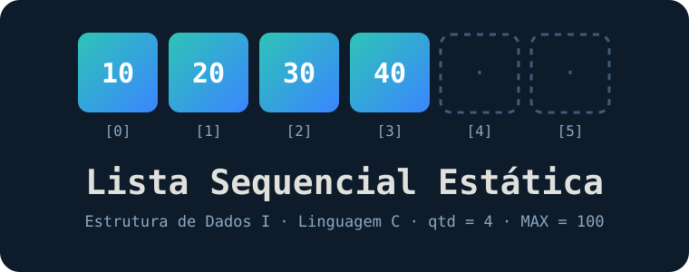

<div align="center">


# Lista Sequencial Estática


**Cadastro de alunos em terminal, feito em C com uma lista sequencial estática (vetor de tamanho fixo).**

</div>

---

## Sobre o projeto

Projeto de estudo da disciplina **Estrutura de Dados I**. A ideia é treinar lógica de programação e entender, na prática, como uma estrutura de dados funciona por dentro: onde cada elemento fica na memória, o que acontece ao inserir ou remover, e o que custa cada operação.

O programa guarda até **100 alunos** (matrícula, nome e 3 notas) em um vetor de tamanho fixo e oferece um menu interativo no terminal para inserir, remover e consultar.

## Funcionalidades

<div align="center">

<table align="center">
  <thead>
    <tr><th align="center">Menu</th><th align="left">Operação</th></tr>
  </thead>
  <tbody>
    <tr><td align="center"><code>E</code></td><td>Verificar se a lista existe</td></tr>
    <tr><td align="center"><code>C</code></td><td>Verificar se a lista está cheia</td></tr>
    <tr><td align="center"><code>V</code></td><td>Verificar se a lista está vazia</td></tr>
    <tr><td align="center"><code>T</code></td><td>Mostrar o tamanho da lista</td></tr>
    <tr><td align="center"><code>O</code></td><td>Abrir o menu de operações (abaixo)</td></tr>
    <tr><td align="center"><code>S</code></td><td>Sair</td></tr>
  </tbody>
</table>

</div>

<div align="center">

**Menu de operações**

<table align="center">
  <thead>
    <tr><th align="center">Opção</th><th align="left">O que faz</th></tr>
  </thead>
  <tbody>
    <tr><td align="center"><code>1</code></td><td>Criar a lista</td></tr>
    <tr><td align="center"><code>2</code></td><td>Inserir no <b>final</b></td></tr>
    <tr><td align="center"><code>3</code></td><td>Inserir no <b>início</b></td></tr>
    <tr><td align="center"><code>4</code></td><td>Inserir no <b>meio</b>, mantendo a ordem crescente de matrícula</td></tr>
    <tr><td align="center"><code>5</code></td><td>Remover do final</td></tr>
    <tr><td align="center"><code>6</code></td><td>Remover do início</td></tr>
    <tr><td align="center"><code>7</code></td><td>Remover pela matrícula</td></tr>
    <tr><td align="center"><code>8</code></td><td>Consultar pela <b>posição</b></td></tr>
    <tr><td align="center"><code>9</code></td><td>Consultar pela <b>matrícula</b></td></tr>
  </tbody>
</table>

</div>

Regras que o programa aplica:

- **Matrícula única:** se você tentar cadastrar uma matrícula que já existe, o programa avisa e pede outra, sem perder o nome e as notas já digitados.
- **Lista cheia ou vazia:** inserir na lista cheia e remover da lista vazia são recusados com mensagem clara.
- **Lista inexistente:** qualquer operação antes de criar a lista mostra um aviso em vez de quebrar.

## Como usar

### Pré-requisitos

- Um compilador C (**GCC** / MinGW no Windows)
- `make` (opcional, só para facilitar)

### Compilar e executar

```bash
git clone https://github.com/Samuelx0R/lista-sequencial-estatica.git
cd lista-sequencial-estatica

make            # gera o executável "lista"
./lista         # no Windows: lista.exe
```

Sem `make`:

```bash
gcc -Wall -Wextra -std=c99 -o lista src/*.c
```

Com **Code::Blocks**: abra `ListaSequencialEstatica.cbp` e use *Build and run* (F9).

### Exemplo de uso

Passo a passo para cadastrar um aluno e consultá-lo:

1. No menu principal, digite `O` (operações).
2. Digite `1` para criar a lista.
3. Digite `2`, informe o nome, a matrícula e as 3 notas.
4. Para ver o aluno, abra `O` de novo, escolha `8` e informe a posição `1`.

Se a matrícula já estiver cadastrada, a tela mostra:

```text
Matricula ja cadastrada!
 ! Insira outra matricula:
```

E a consulta de um aluno aparece assim:

```text
==================== Samuel ====================
Nome: Samuel
Matricula: 2023007
[1] - Nota: 6.00
[2] - Nota: 7.00
[3] - Nota: 8.00
==================== Samuel ====================
```

## Estrutura do projeto

```text
lista-sequencial-estatica/
├── assets/
│   └── logo.svg
├── src/
│   ├── main.c               # só chama o menu
│   ├── Interface.c / .h     # menu, leitura e exibição (tudo que fala com o usuário)
│   └── ListaSequencial.c / .h   # a estrutura de dados em si
├── ListaSequencialEstatica.cbp  # projeto do Code::Blocks
├── Makefile
├── LICENSE
└── README.md
```

O projeto é dividido em três camadas, e cada uma só conhece a de baixo:

```text
main.c  →  Interface.c  →  ListaSequencial.c
(entrada)   (usuário)       (dados)
```

### Como a lista funciona

```c
struct lista {
    int qtd;                     // quantos alunos existem agora
    struct aluno dados[MAX];     // vetor fixo de 100 posições
};
```

A `struct lista` fica escondida no `.c`. O resto do programa só enxerga um ponteiro opaco (`typedef struct lista Lista`) e usa as funções públicas.

**Códigos de retorno das operações**

| Código | Significado |
|:---:|---|
| `1` | Sucesso |
| `0` | Lista cheia (inserção) ou vazia (remoção/consulta) |
| `2` | Matrícula duplicada (inserção), matrícula não encontrada (remoção) ou posição inválida (consulta) |
| `-1` | Lista inválida (ponteiro `NULL`) |

**Custo de cada operação** (n = quantidade de alunos)

| Operação | Custo | Por quê |
|---|:---:|---|
| Consultar por posição | O(1) | acesso direto ao índice |
| Remover do final | O(1) | só diminui `qtd` |
| Inserir no final | O(n) | verifica matrícula duplicada percorrendo a lista |
| Inserir no início / meio | O(n) | verifica duplicada e desloca os elementos |
| Remover do início / meio | O(n) | desloca os elementos |
| Consultar por matrícula | O(n) | busca sequencial |

## Pontos fortes

- **Encapsulamento (TAD):** quem usa a lista não mexe no vetor diretamente, só pelas funções.
- **Código organizado em camadas:** a `main` é limpa, a interface é separada e a estrutura de dados não imprime nada.
- **Tratamento de erros por códigos de retorno**, sem `exit()` no meio da lógica.
- **Proteção contra ponteiro nulo** nas funções de operação da lista.
- **Sem vazamento de memória:** a lista é liberada ao sair e ao recriar. Testei com AddressSanitizer e UBSan, sem erros nos cenários que executei.
- **Integridade dos dados:** matrícula única e inserção ordenada.
- **Portável:** compila no Windows e no Linux (o comando de limpar a tela se adapta ao sistema).
- Compila sem avisos com `-Wall -Wextra` (usando o `make` do projeto).

## Melhorias futuras

- [ ] **Validar as entradas.** Hoje uma letra digitada onde se espera número pode confundir o menu. A ideia é ler com `fgets` e converter com `strtol`.
- [ ] Limitar o tamanho do nome e aceitar só notas entre 0 e 10.
- [ ] Pedir confirmação antes de recriar uma lista que já tem alunos.
- [ ] **Implementar a Fila Estática e a Pilha Estática**, reaproveitando a mesma organização em camadas.
- [ ] Trocar o vetor fixo por **alocação dinâmica** (`realloc`) para não ter limite de 100.
- [ ] Salvar e carregar a lista de um arquivo.
- [ ] Mostrar a média das notas e listar todos os alunos.
- [ ] Usar busca binária na consulta por matrícula quando a lista estiver ordenada.
- [ ] Criar testes automatizados para as funções da lista.
- [ ] Substituir os `goto` do menu por laços (`do/while`).

## O que eu pratiquei

- Ponteiros, `struct` e passagem de parâmetros por valor e por referência
- Alocação e liberação de memória com `malloc` e `free`
- Deslocamento de elementos em vetor (inserir e remover no meio)
- Tipo abstrato de dados e modularização em vários arquivos (`.c` e `.h`)
- Depuração e testes com entradas inválidas

## Licença

Distribuído sob a licença MIT. Veja o arquivo [LICENSE](LICENSE).

---

<div align="center">



</div>
